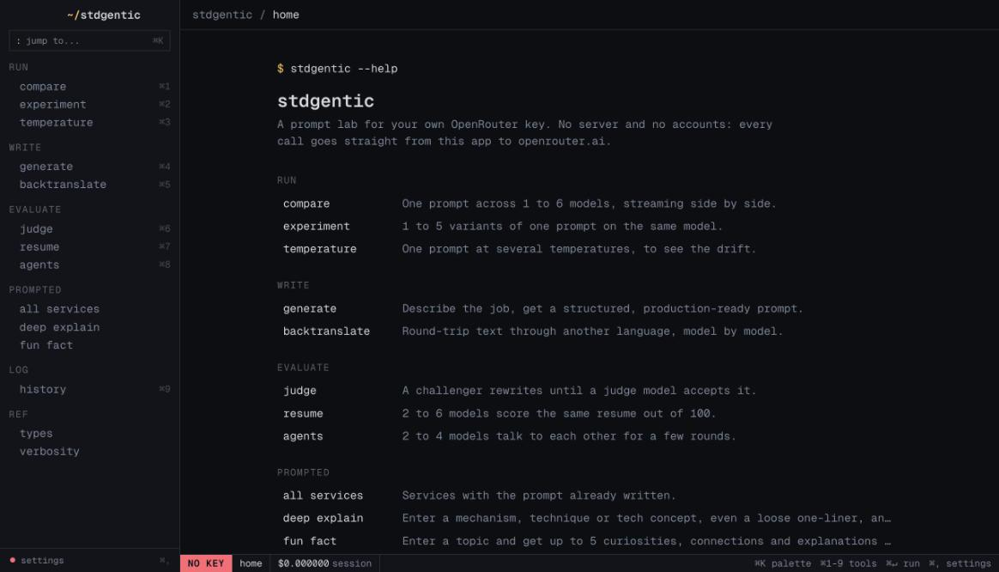
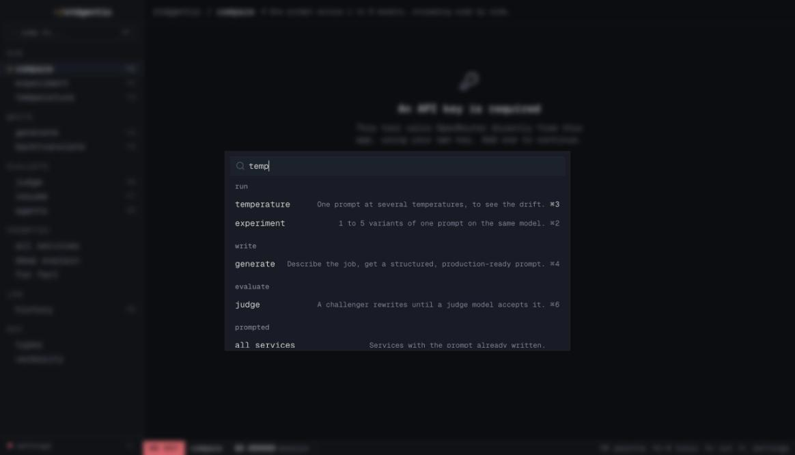
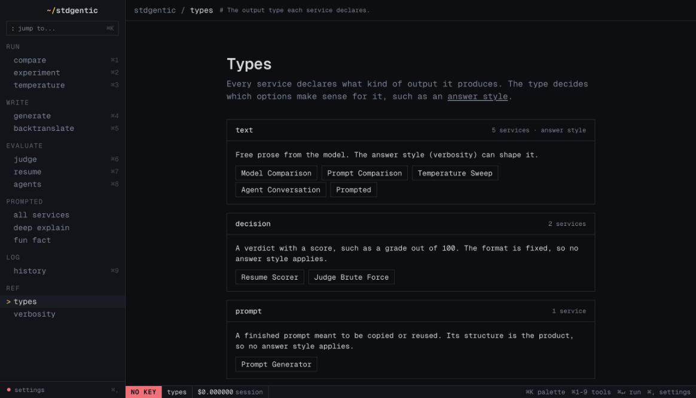

# stdgentic

A harness lab for macOS with a full-terminal look, inspired by cmux. Compare
models, test prompt variants, sweep temperatures, generate prompts, judge,
backtranslate, score resumes and let models talk, all from one window with a
sidebar, a status bar and a `⌘K` palette.







## How it is built

- **[Tauri 2](https://tauri.app)**, with a Rust core, makes it a native
  macOS `.app`. It owns the window, the overlay title bar and the native save
  dialog for exports.
- **Terminal UI**: one ANSI palette drives every component, monospace
  everywhere, no radius, no shadows. The tokens live in `app/globals.css`, so
  a new theme is one block of colors.
- `lib/nav.ts` is the single list of tools. The sidebar, the palette, the
  `⌘1`-`⌘9` shortcuts and the home screen all read it, so a new tool only
  needs an entry there.
- **No server**: no accounts, no database, no telemetry. The only host the app
  contacts is your LLM gateway.

## Your key

Model calls are billed to your own LLM gateway key. It is stored locally on
this machine and sent to the gateway and nowhere else. The status bar shows
what the gateway has charged since the app opened.

## Shortcuts

| Keys | Action |
|---|---|
| `⌘K` | command palette |
| `⌘1`-`⌘9` | jump to a tool |
| `⌘↵` | run, inside a prompt field |
| `⌘,` | settings |

## Commands

Needs Rust (`rustup`) and the Xcode command line tools.

```bash
pnpm install
pnpm tauri dev            # the app, with hot reload
pnpm tauri build          # .app and .dmg in src-tauri/target/release/bundle/
pnpm lint && pnpm typecheck && pnpm test
```
